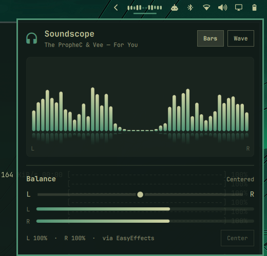
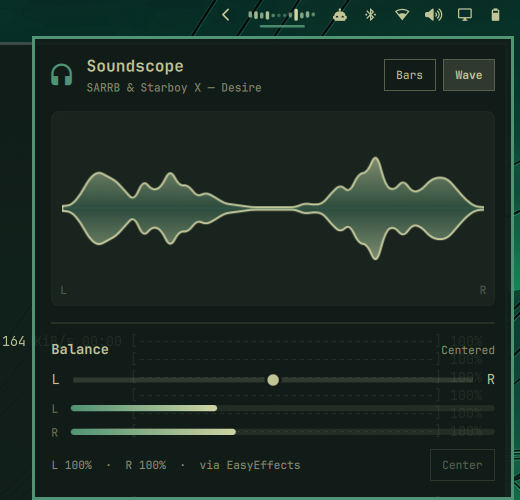

# Soundscope

A live audio visualizer for the [Omarchy](https://omarchy.org) bar, with a
left/right balance control.

<p>
  
  
</p>

- **In the bar:** a small spectrum that moves with whatever is playing.
- **Click it:** a panel with a large visualizer (**Bars** or **Wave**), the
  current track, live L/R output meters, and a **balance** slider.
- **Matches your theme:** colors come from the active Omarchy theme and
  update when you switch themes. The panel is translucent.

## Requirements

- Omarchy (the Quickshell-based `omarchy-shell`)
- [`cava`](https://github.com/karlstav/cava) for the spectrum:

  ```bash
  sudo pacman -S cava
  ```

The balance control works without cava. Without it, the visualizer shows an
install hint and starts by itself once cava is installed.

## Install

```bash
omarchy plugin add https://github.com/Titas-Ghosh/omarchy-soundscope.git --enable
```

It appears in the right side of the bar. Move it with `omarchy bar move`, e.g.

```bash
omarchy bar move titas.soundscope --section left
```

## Using it

| Action | What it does |
|---|---|
| Left-click | Open / close the panel |
| Right-click | Reset balance to center |
| Middle-click | Switch between Bars and Wave |
| In the panel: `h` / `l` or arrows | Nudge balance left / right |
| In the panel: `c`, `0` or Enter | Center the balance |
| In the panel: `b` / `w` | Bars / Wave |

Scriptable (handy for keybindings):

```bash
omarchy-shell soundscope set -0.2     # lean left: right channel at 80%
omarchy-shell soundscope nudge 0.05
omarchy-shell soundscope center
omarchy-shell soundscope style wave
omarchy-shell soundscope get
```

## How balance works

Balance is applied as per-channel volume (the louder side always stays at
100%) on:

- the **EasyEffects** input sink, when EasyEffects is running, otherwise
- your default output.

Using the EasyEffects sink matters: Omarchy's volume keys and audio panel set
every channel of the physical output to the same level, which would erase a
balance stored there. Nothing touches the EasyEffects sink's volume, so the
balance survives volume changes. Soundscope reapplies it whenever EasyEffects
restarts.

Your balance and visualizer style are saved in
`~/.local/state/soundscope.json`.

## Settings

In `~/.config/omarchy/shell.json`, on the widget's bar entry:

```json
{ "id": "titas.soundscope", "bars": 16, "panelOpacity": 0.9 }
```

| Key | Default | Meaning |
|---|---|---|
| `bars` | `12` | Number of bars in the bar widget (4–24) |
| `panelOpacity` | `0.9` | Panel background opacity (0.3–1) |

## License

MIT
